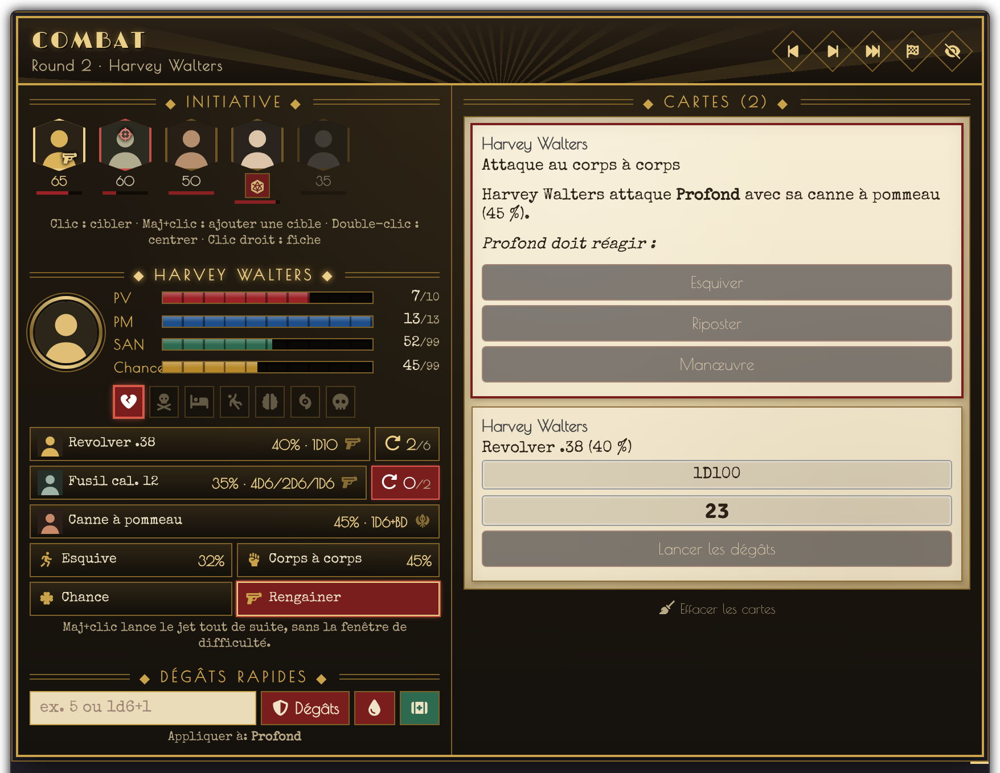
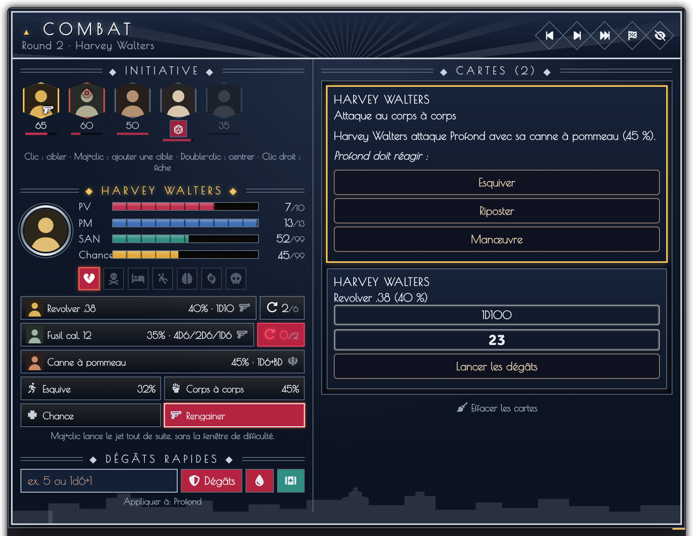
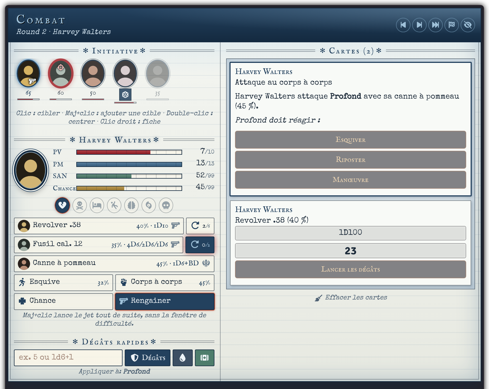

<p align="center"></p>

# Combat Cthulhu HUD — version française pour Foundry v14

HUD de combat pour **L'Appel de Cthulhu v7** sur **Foundry VTT**. Il réunit dans un seul panneau tout ce qui compte pendant un combat : ordre d'initiative, caractéristiques de l'investigateur, attaques, munitions, dégâts et les cartes de combat du système, jouables directement.

> Ce module est le portage en **Foundry v14** et la **traduction française** de [Combat Cthulhu HUD](https://github.com/juninhoneiva/combatcthud) de **juninhoneiva** (licence MIT). Tout le mérite du module original lui revient. Le README original en portugais est dans [`README.pt-BR.md`](README.pt-BR.md).

<p></p>

## Prérequis

- Foundry VTT **v13 ou v14** (vérifié en 14.368)
- Système **Call of Cthulhu 7th Edition (CoC7)** 8.14 ou plus (vérifié en 8.15)
- Facultatif : [PopOut!](https://github.com/League-of-Foundry-Developers/fvtt-module-popout), pour ouvrir le HUD dans une fenêtre séparée

## Installation

Dans **Modules complémentaires › Installer un module**, collez le lien de manifeste :

```
https://github.com/magisterphamtom/combatcthud/releases/latest/download/module.json
```

Activez ensuite le module dans votre monde. Le HUD apparaît dès qu'un combat est en cours sur la scène.

## Fonctionnalités

### Initiative
- Portraits des combattants dans l'ordre du tour, avec mise en avant de celui qui agit.
- **Clic** : cibler (**Maj+clic** ajoute une cible) · **double-clic** : centrer sur le jeton · **clic droit** : ouvrir la fiche.
- Indique qui a une arme à feu dégainée et respecte la règle optionnelle d'initiative de CoC7 (niveau de réussite).

### Investigateur
- Barres de **PV, PM, SAN et Chance**.
- États CoC7 : blessure grave, mourant, inconscient, à terre, folie passagère, folie persistante, mort. Un clic les active ou les désactive.
- MJ et joueurs utilisent le HUD ; chaque joueur voit son propre investigateur.
- **PV privés** : le MJ voit les PV de tous ; chaque joueur ne voit que ceux de ses investigateurs.

### Actions rapides
- **Attaquer** avec chaque arme du personnage, avec le déroulement normal de CoC7 (contact ou distance, contre la cible sélectionnée).
- **Munitions** : les armes à feu affichent les balles dans le chargeur (ex. `4/6`). Clic sur recharger = chargeur plein (annoncé dans le chat) ; Maj+clic = +1 balle ; clic droit = −1 balle.
- **Esquiver**, compétences de **Corps à corps**, jet de **Chance**, **lancer l'initiative** et **dégainer/rengainer**.
- **Maj+clic** sur une attaque ou un jet lance directement, sans la fenêtre de difficulté.

### Dégâts rapides
- Valeur fixe ou formule (ex. `1d6+1`).
- Trois modes : dégâts avec armure, dégâts directs, soins.
- S'applique aux cibles sélectionnées, avec les règles de CoC7 (blessure grave, mort, etc.).

### Cartes du système dans le HUD
Les cartes de combat que CoC7 envoie dans le chat apparaissent dans une colonne à droite du HUD et **fonctionnent sur place** : attaques, esquive, riposte, manœuvre, dégâts, dépense de Chance, jets redoublés, jets de SAN, de CON et opposés.

| Type de jet | Qui le voit dans le HUD |
| --- | --- |
| Public | Tout le monde, résultats visibles |
| Privé | Le MJ et l'auteur du jet |
| Aveugle | Le MJ ; l'auteur voit la carte sans les résultats |
| Pour moi | Le MJ et l'auteur du jet |

À chaque round, le HUD ne garde que les cartes de l'action en cours (le chat les conserve toutes). En option, les cartes affichées dans le HUD peuvent être masquées du chat.

### Thèmes
| Thème | Style |
| --- | --- |
| **Années 20** | Art Déco noir et or |
| **New York années 20** | Bleu nuit et chrome, silhouette de Manhattan, ambre de Broadway |
| **Par-delà les Montagnes Hallucinées** | Carnet d'expédition polaire, bleu glacier, machine à écrire |
| **New York 2026** | Verre fumé, LED, signalétique du métro new-yorkais |
| **Antarctique 2026** | Tablette de station polaire, blanc glacier et orange sécurité |
| **Pulp** | Magazine d'horreur des années 30, façon Weird Tales |
| **Moderne** | HUD tactique en verre dépoli |

<p>
  
  
</p>

Les thèmes Années 20, New York, Montagnes Hallucinées, New York 2026 et Antarctique 2026 existent aussi pour le chat et Token Action HUD : le module [CoC7 – Cartes de chat thématiques](https://github.com/magisterphamtom/coc7-cartes-chat) peut les appliquer partout d'un seul réglage.

Chaque utilisateur choisit son thème.

## Utilisation
- **Maj+H** affiche ou masque le HUD (il y a aussi un bouton dans les outils Jetons).
- Faites glisser le HUD par son en-tête pour le déplacer ; la position est mémorisée.
- Cliquez sur le titre d'une section pour la replier ou la déplier.

## Réglages

| Réglage | Rôle | Par défaut |
| --- | --- | --- |
| Afficher le HUD de combat | Active ou désactive le HUD dans ce navigateur | Oui |
| Seulement pendant les combats | N'affiche le HUD que pendant une rencontre | Oui |
| Thème | Apparence du HUD | Années 20 |
| Cartes dans le HUD | Nombre de cartes CoC7 gardées dans le HUD (0 désactive) | 3 |
| Effacer les cartes du HUD | À chaque round, à chaque tour ou jamais | À chaque round |
| Masquer du chat les cartes du HUD | Évite de voir deux fois la même carte | Non |
| Dégâts rapides pour les joueurs | Autorise les joueurs, sur leurs propres acteurs (réglage du monde) | Non |

## Langues
Français, anglais et portugais (Brésil).

## Crédits et licence
- Module original : **juninhoneiva** — [github.com/juninhoneiva/combatcthud](https://github.com/juninhoneiva/combatcthud)
- Portage v14 et traduction française : **magisterphamtom**
- Code sous licence [MIT](LICENSE).
- Polices incluses : Limelight, Poiret One, IM Fell English, Rajdhani et Inter (SIL Open Font License 1.1), Special Elite (Apache 2.0). Licences dans [`fonts/`](fonts).

Call of Cthulhu est une marque déposée de Chaosium Inc. Ce module n'est pas affilié à Chaosium.
